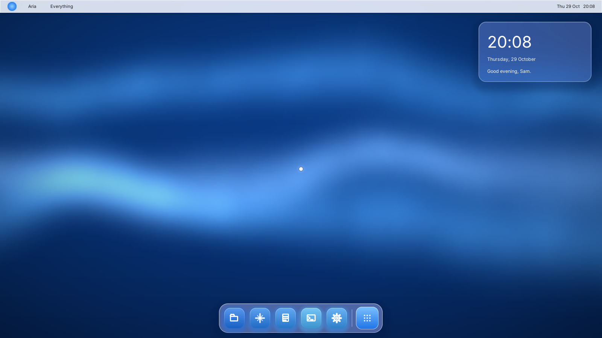
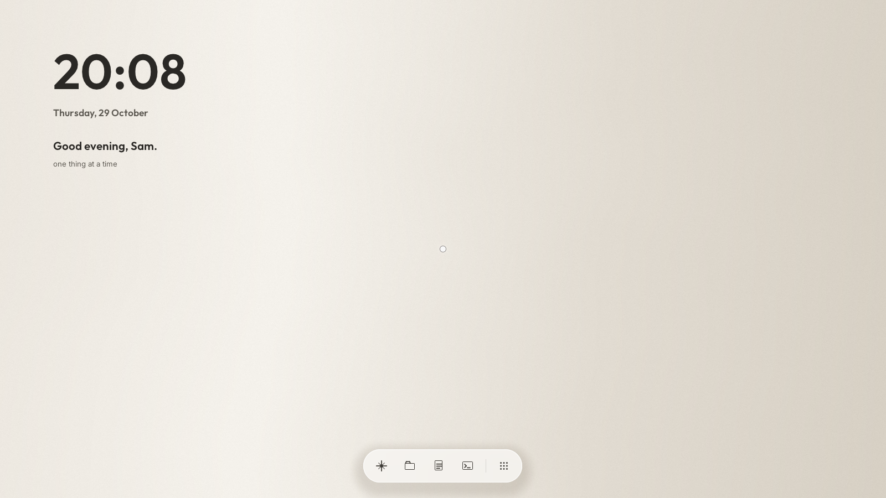
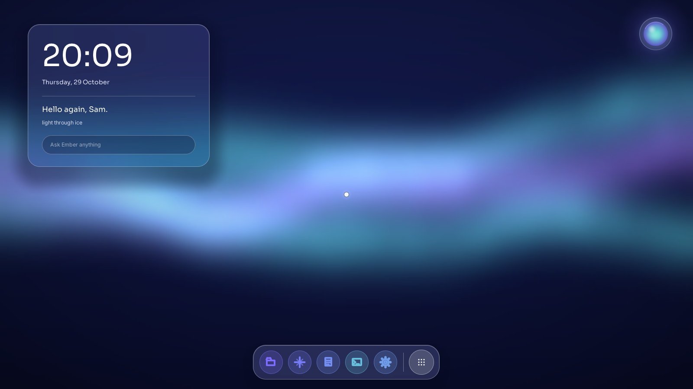
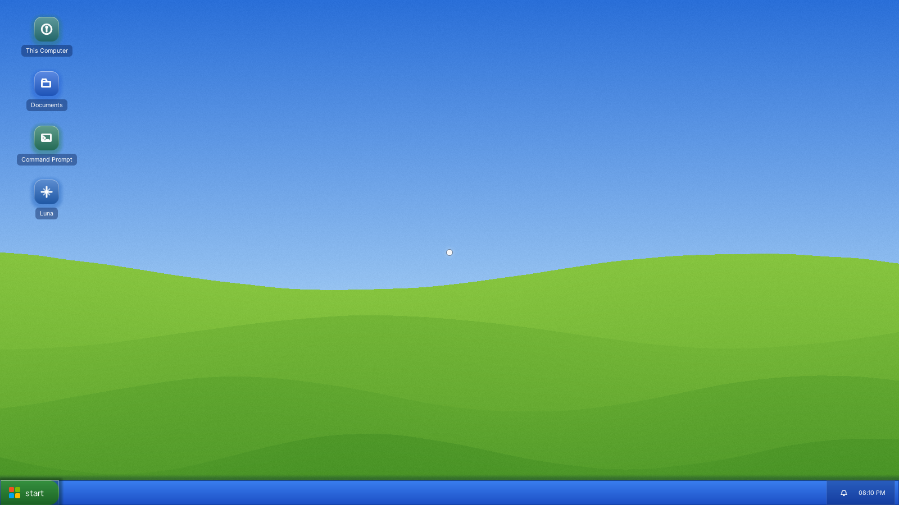
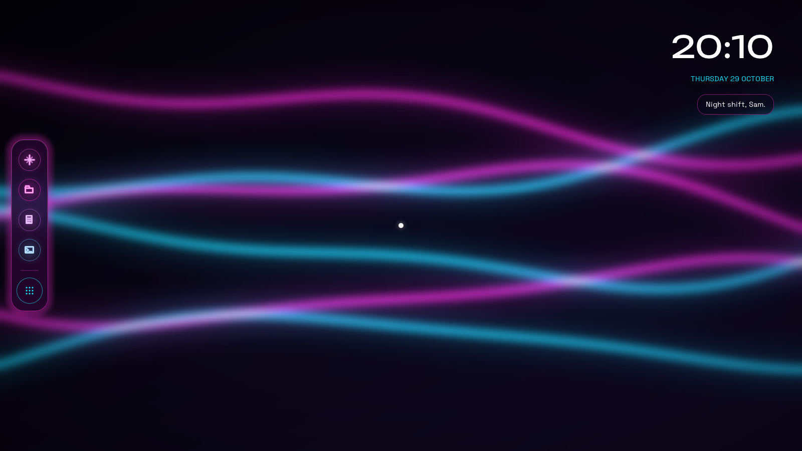
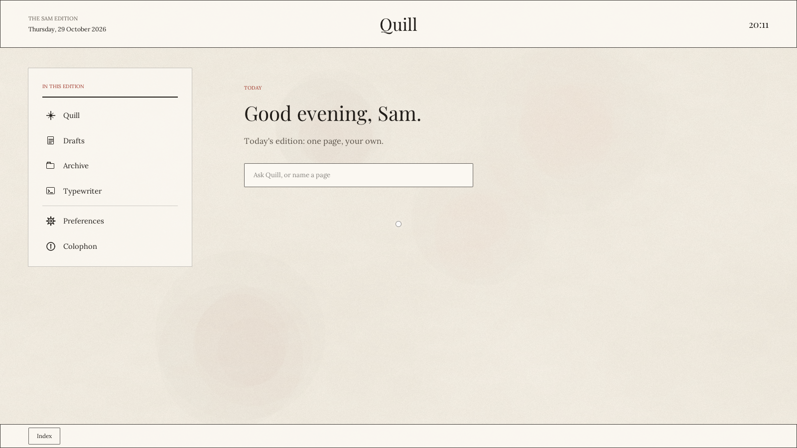

# Operating System

An operating system written from scratch in C, inspired by OS1 in *Her*. You talk
to it, it gets to know you, and it designs your whole desktop. There is no stock
theme, start menu or file explorer.

In short: our own x86-64 kernel, whose native system call interface is the Linux
ABI (so musl, llama.cpp, whisper.cpp, Wayland apps and Firefox can run on it),
an AI daemon with on-device voice and a bundled local model, and **Facet**, the UI
language the AI uses to design every screen.

## What it looks like

Every desktop is written by the AI for the person in front of it, so no two look alike. These are the
six starter designs it can begin from, as they look on first boot:

| | |
|---|---|
|  |  |
| **Aqua** | **Calm** |
|  |  |
| **Frost** | **Luna** |
|  |  |
| **Neon** | **Paper** |

## Building (inside WSL Ubuntu or Linux)

```
sudo apt install -y build-essential qemu-system-x86 xorriso ovmf mtools git
make          # kernel + bootable ISO (fetches the Limine bootloader into vendor/)
make run      # boot in QEMU with UEFI, serial log in the terminal
make test     # headless boot tests (UEFI and BIOS), with a scratch disk attached
make test-persist  # two boots on one disk image: data must survive the power cycle
```

On macOS, install Docker and `brew install qemu`: `make` builds in an x86-64 Ubuntu container and
`make run` boots it in the Mac's QEMU.

## Layout

| Path | What |
|---|---|
| `boot/` | bootloader config (Limine loads us; everything after that is ours) |
| `kernel/arch/x86_64/` | GDT/TSS, IDT, interrupt and syscall entry, APIC, ACPI, SMP, FPU/XSAVE |
| `kernel/mm/` | physical frame allocator (with per-page refcounts), kernel page tables, heap, user address spaces, page objects (paged storage behind ramfs/memfd that MAP_SHARED maps directly) |
| `kernel/sched/` | scheduler, wait queues |
| `kernel/fs/` | VFS, ramfs, initramfs unpacker, pipes |
| `kernel/proc/` | processes, signals, exit/wait, ELF loader |
| `kernel/linux/` | the Linux system call table and implementations |
| `kernel/drivers/` | serial, framebuffer console, tty, time (RTC/TSC), QEMU fw_cfg, PCI, e1000, AHCI and virtio-blk disks (block layer: /dev/sdX) |
| `userland/` | PID 1 (musl) and the initramfs root files |
| `kernel/third_party/` | `limine.h` (BSD-0), `font8x8_basic.h` (public domain) |
| `tests/` | QEMU boot tests |

## Status

- [x] Milestone 1 (kernel core): boot, serial and framebuffer log, GDT/TSS/IDT, exceptions, PMM, own page tables (W^X), heap. `make test` passes under UEFI and BIOS
- [x] Milestone 2 (core): ACPI/MADT, x2APIC/xAPIC + I/O APIC, APIC timer, SMP (all cores), preemptive
      scheduler, wait queues; user mode with SYSCALL entry and XSAVE (AVX) state; demand-paged address
      spaces; VFS + ramfs + initramfs (cpio) + /dev (console tty, null, zero, urandom) + pipes; ELF loader
      (static, static-pie, dynamic via PT_INTERP) and `#!` scripts; fork/vfork/execve/wait4, signals with
      handlers, ~130 Linux system calls. A musl-built PID 1 and Ubuntu's glibc busybox run unmodified;
      `make test` runs the userland suite under UEFI and BIOS.
- [x] Networking: PCI, Intel e1000 driver, IPv4/ARP/ICMP/UDP/TCP/DHCP in the kernel, Linux socket API;
      mbed TLS in user space with certificate verification; AI providers (Anthropic, OpenAI-compatible,
      Gemini, Azure) reached over HTTPS from inside the OS
- [x] Graphics and input: /dev/fb0 (fbdev, write-combining mmap), PS/2 keyboard and the vmmouse absolute
      pointer as evdev devices, SMP reschedule IPIs
- [x] The experience: first boot, onboarding conversation with AI-invented picks, the AI designing the
      entire desktop (Facet), living wallpapers, glass, vector icons, live redesign by conversation
- [x] Threads: clone/clone3 with CLONE_THREAD (musl and glibc pthreads run unmodified), futex
      (wait/wake, bitsets, timeouts, requeue, wake-op), per-thread signals (tkill/tgkill), exit vs
      exit_group, TLB shootdown IPIs, user copies with an exception fixup table
- [x] Storage: AHCI (SATA) and legacy virtio-blk drivers; disks are Linux block devices /dev/sda, /dev/sdb...
      (byte-granular read/write, lseek/fstat size, BLKGETSIZE64/BLKSSZGET, fsync flushes the drive cache).
      `make run` and the launchers attach `build/os-disk.img` (1 GiB, sparse; `make clean` keeps it)
- [x] Linux apps: ptys and a terminal app; AF_UNIX sockets with SCM_RIGHTS, epoll, eventfd, timerfd,
      signalfd, memfd, real MAP_SHARED (page objects); /proc and /sys. Ubuntu's glibc programs run
      unmodified from the sysroot (`scripts/build-sysroot.sh`): Python 3, Weston's Wayland clients
- [x] the OS's own Wayland compositor in the shell (`userland/shell/wl`): apps' windows are framed by
      the person's design; `tests/wl_os_test.py` checks a live app inside the OS
- [x] Memory: `/etc/os` (design, portrait, conversation) and `/root` are kept on the disk
      (`shell/store.c`, crash-safe two-slot archive), restored at boot; the companion welcomes them back
- [x] Sound and voice: Intel HDA driver (`/dev/dsp`, `/dev/mixer`); the companion speaks (Piper) and
      listens (whisper.cpp, Ctrl+Space), on this computer
- [ ] Next: the offline built-in model, Wi-Fi, GTK/Chromium apps (Prism), copy-on-write fork

## The experience (userland/shell)

`os-shell` is everything a person sees. The first-boot screens (choose a mind, connect) are the only
ones in the OS's own plain style. From the onboarding conversation on, the AI shapes everything:

- **Onboarding** (`onboard.c`): a conversation with visual picks the AI invents (palettes, moods), plus
  the questions the plan leaves to onboarding: the AI's name, the background, how autonomous it may be,
  and whether it may redesign later.
- **Facet markup** (`shell/fm/`): the AI writes the whole desktop as one document, XML-like markup for
  structure and a CSS-like stylesheet for looks. It is not web technology: a small OS-specific vocabulary
  (surfaces docked to screen edges or placed freely, rows, columns, grids, stacks, orbits, popovers,
  sheets, live app lists, window lists, clocks, search, the companion's orb, embedded app views), a subset
  of CSS (gradients, frosted glass, vibrancy, glow, shadows, transitions, transforms), a closed set of
  actions, and a window-frame template. A taskbar with a start menu, a menu bar with a dock, or apps
  orbiting a light are just different documents (see `tests/designs/`). A `<canvas>` element runs a small
  sandboxed Lua script for anything the markup can't express. The validator reports problems back to the
  AI (every app must stay reachable) and text colour is checked against what is actually behind it.
- **The companion drives the UI**: it sees a compact view of the element tree and acts with tags such as
  `[[ui:press #start]]`, `[[ui:style dock { ... }]]`, `[[ui:add #bar <clock/>]]` or `[[ui:remove #x]]`.
  Touched elements glow briefly so the person sees what changed. For a whole new look it redesigns.
- **Desktop** (`desktop.c`, `wallpaper.c`): hosts the document, the windows and the built-in apps.
  Living wallpapers are procedural (AI-chosen kind, colours, seed and intensity).

`tests/fm-dump.sh DOC.xml` runs the engine natively and prints the laid-out tree; `tests/preview.py
DOC.xml OUT.png` boots the OS straight into a document. `tests/demo.py` drives a complete first boot in
QEMU against a local model and saves screenshots.

## Running it

`make` produces `build/os.iso`, which boots on UEFI and BIOS machines, real or virtual. How you run it is
up to you:

- **A virtual machine** (QEMU, VirtualBox, VMware, Hyper-V...): 64-bit, 8 GB of memory or more, 4 CPUs,
  the ISO as its CD, an empty disk on SATA/AHCI or virtio if you want it to remember you, and an Intel
  PRO/1000 (e1000) network adapter. `make run` starts it in QEMU.
- **A real PC:** write the ISO to a USB stick with a raw writer (Rufus in DD mode, balenaEtcher, `dd`), or
  copy the ISO's files onto a FAT32 stick for UEFI. Turn off Secure Boot. It only ever writes to a disk
  that is blank or already its own; any other drive is left untouched.

The first screen asks for a mind: the small model that comes with the system (works offline), a bigger
one downloaded onto this computer, a model on your network (Ollama, LM Studio), or a cloud provider with
your key. To start already connected on a real PC, add `cmdline: os.provider=... os.key=...` to
`boot/limine/limine.conf` (an example is in that file).

Hardware support is still narrow: Intel e1000 networking, AHCI and virtio disks, Intel HD Audio, PS/2
keyboard and mouse (and the VMware/QEMU pointer). USB, NVMe, other network cards and Wi-Fi are not
there yet.

`scripts/` holds the helpers used while developing it, for example `scripts/os-vm.sh` (QEMU with KVM, in
Linux or WSL) and `scripts/os-win.ps1` (Windows QEMU), which can pass AI settings from an `os.conf`
(see `os.conf.example`).

## Trying it

`make run` boots into a busybox shell on the serial console (your terminal). `tests/shell_demo.sh` types
a few commands into it automatically; `tests/debug_boot.sh` boots once with system-call tracing.

## Bundled apps

The OS ships **Prism**, Valerie Liu's agentic IDE, as a bundled app. `make` copies the newest
`Prism-*.AppImage` from the Prism project's `dist` folder into a separate boot module (`apps.cpio`),
which appears inside the OS as `/apps/prism/`. Running it needs the graphical Linux apps milestone:
glibc-style dynamic linking, the system calls Chromium uses (threads, futex, epoll, eventfd, memfd) and a
Wayland display server. Until then the OS lists it as installed but cannot open it yet.

## License

MIT (see LICENSE). Files under `kernel/third_party/` keep their own licenses: `limine.h` is BSD Zero Clause, `font8x8_basic.h` is public domain. Libraries fetched at build time (Limine, musl, mbed TLS, stb, Lua, fonts, llama.cpp and others) come under their own licenses.
